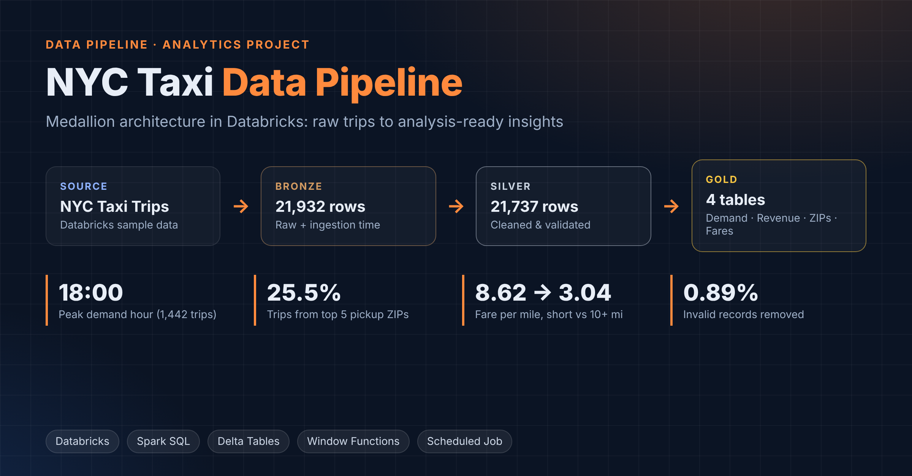
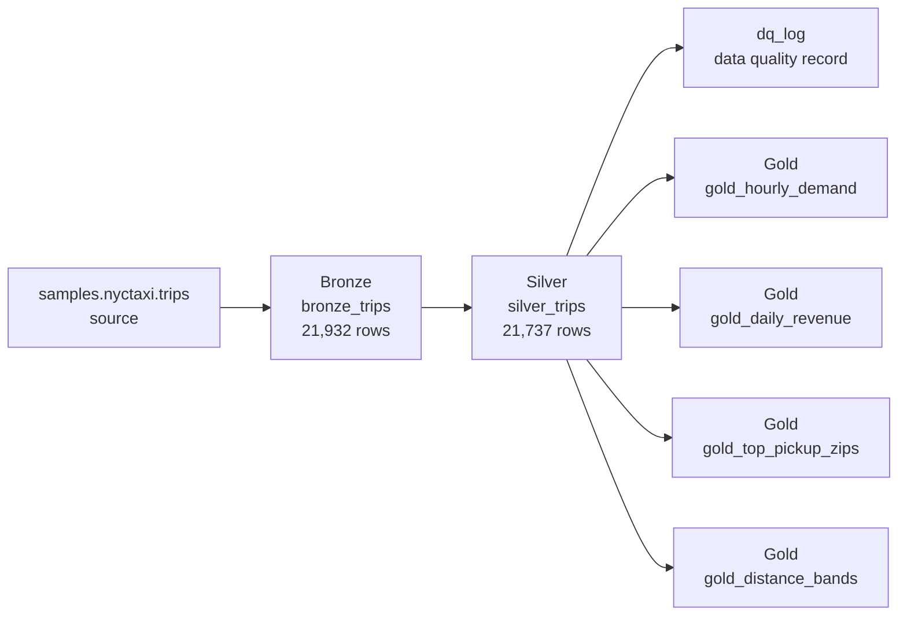
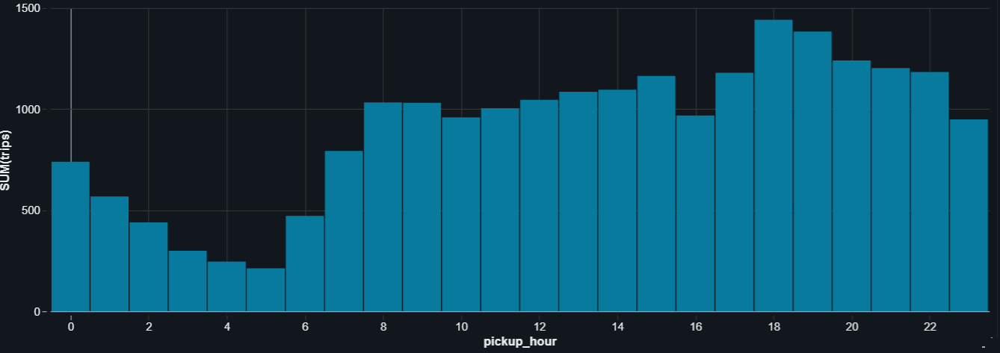
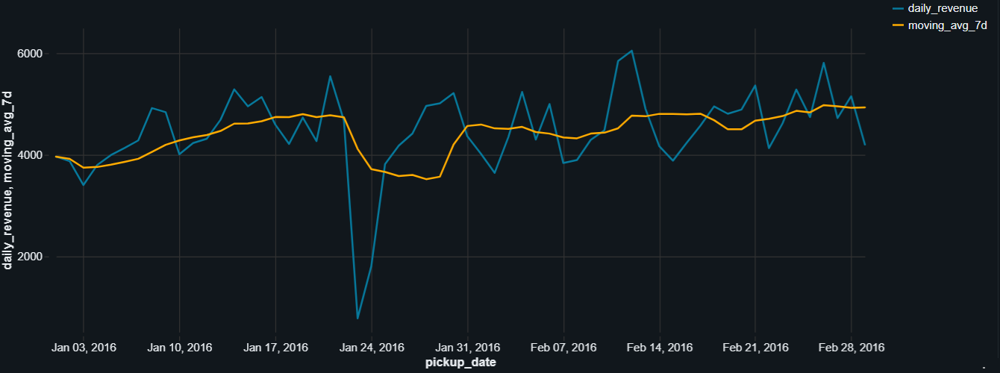

# NYC Taxi Data Pipeline & Analysis



An end-to-end analytics project built in **Databricks** with **SQL** and **Delta tables**. Raw NYC taxi trips are processed through a Bronze → Silver → Gold (medallion) pipeline, validated with data-quality checks, and summarised into analysis-ready tables that answer business questions about demand, location and pricing. The pipeline is scheduled as a daily Databricks Job.

---

## Business questions

1. When during the day is taxi demand and revenue highest?
2. Which pickup areas generate the most trips?
3. How do fare and fare-per-mile change with trip distance?
4. How stable is daily revenue, and where are the outliers?
5. How much of the raw data is unusable, and why?

## Architecture



| Layer | Table | Purpose | Rows |
|---|---|---|---|
| Bronze | `bronze_trips` | Raw source data plus ingestion timestamp | 21,932 |
| Silver | `silver_trips` | Validated trips with derived time and duration columns | 21,737 |
| Silver | `dq_log` | Rows in, rows out, rows removed per run | 1 |
| Gold | `gold_hourly_demand` | Trips and fares by pickup hour | 24 |
| Gold | `gold_daily_revenue` | Daily revenue, running total, 7-day moving average | 60 |
| Gold | `gold_top_pickup_zips` | Pickup ZIPs ranked by trips with share of total | 118 |
| Gold | `gold_distance_bands` | Fare, fare per mile and duration by distance band | 5 |

## Data quality rules (Silver)

| Rule | Reason |
|---|---|
| `trip_distance > 0` | Zero or negative distance is not a real trip |
| `fare_amount > 0` | Zero or negative fares indicate refunds or errors |
| `dropoff > pickup` | Timestamps must be in order |
| Duration 1–180 minutes | Removes instant and implausibly long trips |

**Result:** 195 of 21,932 records removed (**0.89%**).

## Key findings

| Area | Finding |
|---|---|
| Demand by hour | Peak at **18:00 (1,442 trips)**; lowest at **05:00 (212 trips)** |
| Location | ZIP **10001** is the busiest pickup area (1,218 trips, 5.6%); the **top 5 ZIPs account for 25.5%** of all trips |
| Pricing | Average fare rises from **5.43** (under 1 mile) to **44.57** (10+ miles), while fare per mile falls from **8.62 to 3.04** |
| Revenue | Average daily revenue **4,461.96**; lowest day **2016-01-23** (770.00, 77 trips); highest **2016-02-12** (6,052.00, 425 trips) |

### Trips by pickup hour



### Daily revenue with 7-day moving average



**Fare by distance band**

| Distance band | Trips | Avg fare | Fare per mile | Avg duration (min) |
|---|---|---|---|---|
| Under 1 mile | 5,242 | 5.43 | 8.62 | 5.3 |
| 1–3 miles | 10,816 | 9.40 | 5.59 | 11.3 |
| 3–6 miles | 3,321 | 16.68 | 4.12 | 19.5 |
| 6–10 miles | 1,236 | 26.01 | 3.37 | 25.2 |
| 10+ miles | 1,122 | 44.57 | 3.04 | 37.2 |

### Business implications

- **Driver supply:** evening hours (18:00–22:00) carry the highest demand, so supply should be weighted toward that window; early morning (03:00–06:00) is the lowest-value period.
- **Location focus:** a quarter of demand comes from five ZIP codes, which makes them the priority areas for positioning and promotions.
- **Pricing:** short trips earn the most per mile because of the fixed starting charge, so short-trip volume is disproportionately valuable.
- **Monitoring:** single-day revenue drops such as 2016-01-23 should be flagged automatically; the dataset has no weather field, so the cause is not confirmed here.

## SQL techniques used

- Medallion layering with `CREATE OR REPLACE TABLE ... AS SELECT`
- Common table expressions (CTEs)
- `CASE WHEN` for derived flags and distance banding
- Window functions: `RANK()`, running total with `SUM() OVER`, share of total with `SUM() OVER ()`, 7-day moving average with `ROWS BETWEEN 6 PRECEDING AND CURRENT ROW`
- `UNION ALL` validation checks across every layer

## Repository structure

```
├── README.md
├── images/
│   ├── cover.png
│   ├── hourly_demand.png
│   └── daily_revenue.png
└── sql/
    ├── 01_setup.sql      # schema
    ├── 02_bronze.sql     # raw ingestion
    ├── 03_silver.sql     # cleaning, validation, dq_log
    ├── 04_gold.sql       # summary tables + row-count validation
    └── 05_analysis.sql   # business questions and key statistics
```

## How to run

1. Create a Databricks workspace (Free Edition works) with serverless compute.
2. Create a SQL notebook and run the files in `sql/` in order (`01` → `05`).
3. Optionally schedule the notebook as a Databricks Job to refresh the tables daily.

## Limitations

- Two-month historical sample (January–February 2016).
- `fare_amount` excludes tips, tolls and surcharges.
- No weather or event data, so the analysis describes patterns rather than causes.

## Tools

Databricks · Spark SQL · Delta Lake · Databricks Jobs
 
